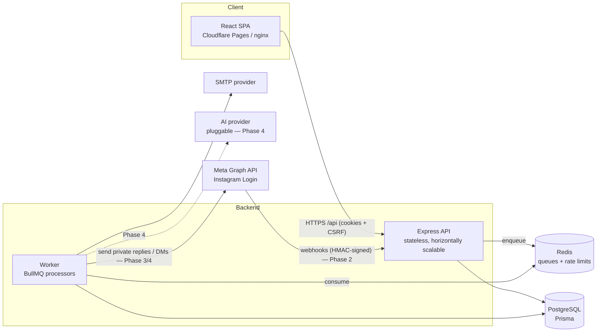

# InstaFlow AI — System Architecture

Status: **Phase 1 implemented** (foundation, auth, tenancy, workspaces, team). Later phases are designed here and marked as such.

## 1. Requirements summary

InstaFlow AI is a multi-tenant SaaS that lets creators and sellers automate Instagram customer conversations **through official Meta APIs only**:

| Capability | Phase |
|---|---|
| Accounts, workspaces, team roles, security foundation | 1 ✅ |
| Instagram Login OAuth, account/media sync, webhook verification | 2 |
| Keyword rules (Reel-specific + global), comment → private reply pipeline | 3 |
| Incoming DM processing, Smart Inbox, AI replies, product knowledge | 4 |
| Visual flow builder, advanced conditions, human handover | 5 |
| Analytics, multi-account, team permissions, usage limits | 6 |
| Hardening, security review, deployment, monitoring | 7 |

Non-negotiables that shape the architecture:

- **Tenant isolation** is enforced on the server at several independent layers.
- **No unofficial Instagram access.** No passwords, scraping, browser automation or private APIs. Unsupported capabilities are detected and reported, never faked.
- **Automation runs server-side 24/7** in a worker process, independent of any browser tab.
- **At-most-once side effects.** A comment never gets two private replies, even with webhook redelivery or job retries.
- **AI never invents** prices, stock, discounts, delivery promises or policies. It answers only from approved data, or hands off to a human.
- **Free-tier-first.** Everything runs on one small Postgres, one Redis, one API instance and one worker.

## 2. System overview



**Why this shape.** The API only validates, persists and enqueues; slow or rate-limited work (email, Meta calls, AI) happens in the worker. A webhook burst can't time out HTTP requests, and retries never block users. The API is stateless (sessions live in Postgres, rate-limit counters in Redis), so it can scale horizontally later.

## 3. Repository layout

```
instaflow-ai/
├── packages/shared/          # Shared by API + web: RBAC matrix, Zod schemas, DTOs, API envelope
├── apps/api/                 # Express API + BullMQ worker (same codebase, two entrypoints)
│   ├── prisma/               # schema.prisma, migrations/, seed.ts
│   ├── src/
│   │   ├── config/env.ts     # Zod-validated environment (fails fast; prod-only rules)
│   │   ├── lib/              # db, tenant-db, crypto, password, cookies, logger, redis, serializers
│   │   ├── middleware/       # auth, csrf, workspace (+RBAC), rate-limit, error-handler
│   │   ├── modules/<domain>/ # *.routes.ts (thin) → *.service.ts (business logic)
│   │   ├── queues/           # queue names, processors, dispatch, dead-letter
│   │   ├── server.ts         # HTTP entrypoint (graceful shutdown)
│   │   └── worker.ts         # Worker entrypoint (health endpoint, graceful shutdown)
│   └── tests/                # unit/ + integration/ (real PostgreSQL)
├── apps/web/                 # React + Vite + Tailwind v4 + shadcn/ui-pattern components
│   ├── src/components/ui/    # Design-system primitives (Radix-based)
│   ├── src/features/<area>/  # Feature modules (auth, onboarding, team, settings, …)
│   └── e2e/                  # Playwright journeys
├── docs/                     # This documentation
└── docker-compose.yml        # postgres, redis, mailpit, migrate, api, worker, web
```

Business logic never lives in route handlers. Handlers parse input with shared Zod schemas, call a service, and serialize through an explicit DTO allow-list (`lib/serializers.ts`).

## 4. Request lifecycle (API)

Middleware order in `src/app.ts`:

1. `pino-http`: structured logs plus a server-generated `X-Request-Id`. Client IDs are never trusted.
2. `helmet`: strict headers; the CSP is `default-src 'none'` because the API serves only JSON.
3. `cors`: explicit origin allow-list with credentials.
4. *(Phase 2: raw-body webhook route mounted here, before JSON parsing.)*
5. `express.json({ limit: '100kb' })`, then `cookie-parser`.
6. `/api/health`, which is unauthenticated and not rate-limited.
7. Global rate limit (300/min/IP), plus per-endpoint limits on sensitive routes.
8. `loadSession`: resolves the opaque session cookie.
9. `csrfProtection`: required on every unsafe method except webhooks.
10. Routers: `requireAuth`, then `requireWorkspace`, then `requirePermission(...)`.
11. 404, then the central error handler with a consistent envelope (`{ error: { code, message, details?, requestId } }`).

## 5. Multi-tenancy (defence in depth)

Every tenant-owned row has a non-null `workspaceId`. Four independent layers enforce isolation; any one failing still leaves the others:

| Layer | Mechanism | Where |
|---|---|---|
| 1. Membership | `X-Workspace-Id` must be a workspace the user belongs to (and not deleted). Otherwise **404**, which also prevents probing for valid IDs. | `middleware/workspace.ts` |
| 2. Permission | Role-to-permission matrix shared with the UI, enforced server-side | `packages/shared/src/roles.ts`, `requirePermission` |
| 3. Scoped DB client | `forWorkspace(id)` Prisma extension injects `workspaceId` into every query on tenant models. It throws `TenantScopeViolation` on cross-tenant writes or attempts to move a record. | `lib/tenant-db.ts` |
| 4. Database | **Composite foreign keys** `(childFk, workspaceId) → parent(id, workspaceId)`, so Postgres rejects e.g. a Message pointing at another workspace's Conversation | `prisma/schema.prisma` |

Deliberate exceptions, all written only by trusted server code:

- `WebhookEvent.workspaceId` is nullable until the receiving account is identified.
- `AuditLog.workspaceId` is null for user-level events such as login.
- Invitation lookup/accept use the base client. The 256-bit invitation token is the authorization, because the user isn't a member yet.

**Super Admin** is a platform role. It grants the `/api/admin` aggregate API only and gets **no** implicit tenant access; this is tested.

## 6. Authentication & sessions

- **Passwords:** Argon2id (m=19 MiB, t=2, p=1, OWASP minimum). Unknown-email logins verify against a dummy hash so timing does not reveal which accounts exist.
- **Sessions:** opaque 256-bit token in an `httpOnly`, `SameSite=Lax`, `Secure` cookie (`__Host-` prefixed in production). The DB stores only its SHA-256. This gives real logout, "sign out everywhere", and revocation on password reset, which stateless JWTs can't. Expiry slides (30 days idle), refreshed at most every 15 minutes.
- **CSRF:** HMAC-signed double-submit. An httpOnly seed cookie plus `X-CSRF-Token = HMAC(secret, seed)`, which the SPA holds in memory only. The seed rotates on login and logout.
- **Lockout:** 10 consecutive failures lock the account for 15 minutes, on top of per-IP+email rate limits.
- **One-time tokens** (email verification 24 h, password reset 1 h, invitations 7 d) are stored hashed and consumed atomically (`UPDATE … WHERE usedAt IS NULL`). Issuing a new one invalidates the old.
- **Email verification** is required before inviting teammates, and later before connecting Instagram.

## 7. Background processing

BullMQ on Redis. The queue names for every phase are reserved in `queues/names.ts`:

`email` ✅ · `dead-letter` ✅ · `instagram-webhooks` · `comment-processing` · `private-replies` · `incoming-dms` · `ai-responses` · `analytics-aggregation` · `token-health`

- **Retries:** 5 attempts with exponential backoff (10 s → 160 s). Failed jobs are kept 14 days for inspection.
- **Dead-letter queue:** a job that exhausts its retries is copied to `dead-letter` with its failure reason, for inspection and manual retry (admin UI in Phase 6).
- **Idempotency:** `dispatch(..., { jobId })` de-duplicates enqueues. Side-effecting processors (Phase 3+) must first claim `AutomationExecution.idempotencyKey`, which has a **unique** DB constraint, e.g. `private_reply:<commentId>`.
- **Graceful shutdown:** `SIGTERM` lets the worker finish active jobs (30 s grace).
- **Health:** the worker exposes `GET :4001/health` (workers running + Redis ping); the API exposes `/api/health` (liveness) and `/api/health/ready` (DB + Redis).
- **Inline mode:** `QUEUE_MODE=inline` runs processors in-process, for tests and Redis-less development.

## 8. Planned designs for later phases

### Phase 2 — Instagram integration
- An `InstagramAdapter` interface with two implementations: `MetaInstagramAdapter` (real) and `MockInstagramAdapter`. The mock is clearly labelled: `InstagramAccount.isMock = true` and a visible "Mock" badge in the UI.
- **Before writing each endpoint, consult Meta's current documentation** for the Instagram API with Instagram Login: OAuth URLs, scopes, token exchange and refresh, media fields, webhook fields, and private-reply and messaging endpoints. Capabilities vary by API version, account type and app review status. Nothing is assumed from memory.
- **Capability detection** per media item, stored in `InstagramMedia.commentWebhookSupport` + `capabilityNote` and surfaced in the Reels Manager.
- Tokens are encrypted with `TokenCipher` (AES-256-GCM, versioned keys) in `OAuthToken.accessTokenEnc`. A `token-health` job monitors expiry and refresh.
- `GET/POST /api/webhooks/instagram`: verify-token handshake plus `X-Hub-Signature-256` HMAC verification on the **raw body**. Events are persisted with a unique `dedupeKey` before anything else.
- A Meta **data deletion callback** endpoint, required for app review.

### Phase 3 — Comment-to-DM pipeline
```
webhook → verify signature → persist WebhookEvent (unique dedupeKey) → 202
  → [instagram-webhooks] identify workspace/account/media
  → [comment-processing] keyword match (priority order, normalization) → choose ONE rule
  → claim AutomationExecution(idempotencyKey = private_reply:<commentId>)  ← unique constraint
  → eligibility check (account active, media enabled & not excluded, rule enabled, reply not yet sent)
  → [private-replies] Meta API call (rate-limit aware) → record sanitized response → analytics
```

### Phase 4 — AI engine
- Execution order: fixed keyword rules → flow conditions → retrieve approved knowledge → AI (only if confident) → validate → messaging-window check → send → store.
- A provider-independent `AiProvider` interface; the provider is configured per deployment.
- Retrieval uses PostgreSQL full-text search with the `simple` configuration (language-agnostic, works for Tamil script and Tanglish). pgvector is an optional upgrade.
- **Guardrails:** prices, stock and policies are injected only from structured `Product` fields. If one is missing, the answer is "the team will confirm". Output is checked so any number or price must appear in the retrieved context. Low confidence leads to human handover. Token usage goes to `UsageRecord`.

## 9. Key decisions

| Decision | Choice | Why |
|---|---|---|
| Session model | Opaque DB sessions | Revocation, logout-all, reset-revokes-all; no JWT key management |
| Tenant scoping | Middleware + Prisma extension + composite FKs | A single forgotten `where` can't leak data |
| Password hash | Argon2id via `@node-rs/argon2` | OWASP first choice; prebuilt binaries for glibc and musl |
| ORM | Prisma 7 + `@prisma/adapter-pg` | WebAssembly query client, so no native engine in the runtime image |
| Validation | Zod 4 schemas in `packages/shared` | One schema powers API validation and form validation |
| Queue | BullMQ + Redis | Retries, backoff, delayed jobs, rate limiting, mature |
| Frontend | React 19 + Vite 7 + Tailwind v4 + Radix | shadcn/ui pattern: components owned in-repo, accessible primitives |
| Versions | Proven majors (TS 5.9, Vite 7, Vitest 3, React Router 7, BullMQ 5) | Newer majors were very recent; stability over novelty |
